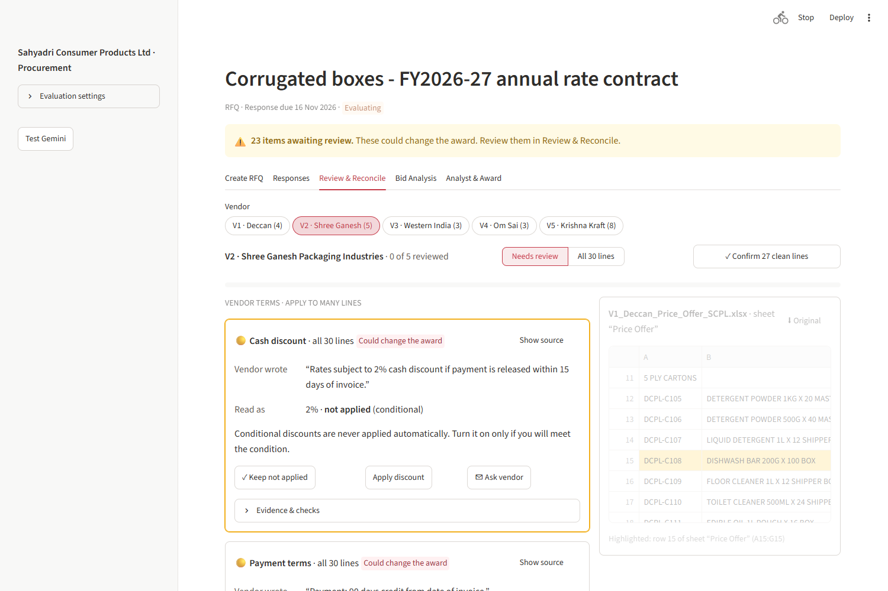
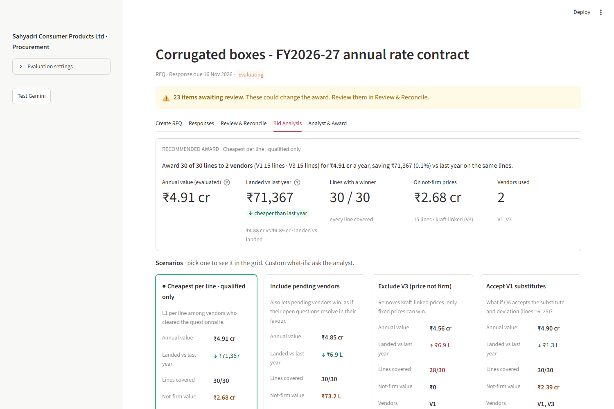
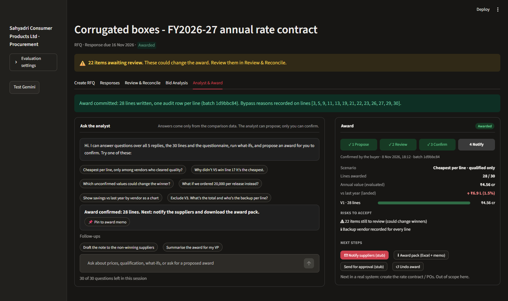

# Kill the Quote Spreadsheet

A Streamlit prototype for a category buyer: draft an RFQ for 30 corrugated-box lines, get five messy vendor replies (Excel, PDF, Word, a phone photo, an email) **extracted by Gemini, normalised to ₹/piece, validated and confidence-scored**, review only what needs a human, compare vendors, and ask an analyst for a defensible, line-wise award that you confirm with one click.
The stubbed parts are the plumbing (sending email, vendor replies to clarifications); **the AI loops are real**.

**Live:** `https://<your-app>.streamlit.app` (public app, passcode on request) · Fictional data: Sahyadri Consumer Products Ltd, 5 vendors, 30 lines.

| Review & Reconcile | Bid Analysis | Analyst & Award |
|---|---|---|
|  |  |  |

## Run locally
```bash
python -m venv .venv && .venv/Scripts/activate        # Python 3.11+ (tested on 3.13)
pip install -r requirements.txt
echo GEMINI_API_KEY=... > .env && echo APP_PASSCODE=... >> .env     # on Streamlit Cloud: st.secrets
streamlit run app.py          # first start builds rfx.db from the seed and the committed extraction cache: 0 API calls, about 7 s
pytest                        # 269 tests, no API key needed
python -m eval.eval_extraction   # needs the private answer key: set ANSWER_KEY_DIR (the app never reads it)
```

## How it works

```mermaid
flowchart LR
  A[inbox: xlsx · pdf · docx · jpg · eml] --> B[preprocess<br/>convert-first]
  B --> C[Gemini extraction<br/>+ second read]
  C --> D[match to our 30 lines]
  D --> E[normalize to ₹/pc<br/>convert + recompute]
  E --> F[validate layers 0-4<br/>completeness · arithmetic · master data · sanity · second read]
  F --> G[confidence from signals<br/>route auto / spot-check / must-confirm]
  G --> H[Review & Reconcile<br/>items, audited actions]
  H --> I[Bid Analysis<br/>scenarios, grid]
  I --> J[Analyst tools<br/>query_view · award_scenario · propose]
  J --> K[Confirm award<br/>audit, memo, Excel]
```


## Key decisions (full list: `CLAUDE.md` §5, `docs/DECISIONS.md`)
| Topic | Decision |
|---|---|
| Comparison unit | ₹ per piece, freight included (FOR Chakan), GST excluded; per-100/1000 divided out, per-kg × theoretical weight, USD at a fixed dated rate |
| Ranking | **Evaluated** price = landed + one-time charges + payment-terms loading (10.9% cost of funds); the grid shows both |
| Missing data | A missing line is `not_quoted`, never ₹0; freight is imputed from other vendors or last year, else the line is excluded; nothing is invented |
| Discounts, tiers | Conditional discounts are never auto-applied (buyer decides, audited); tier basis defaults to *per order* when unclear |
| MSME | Micro/small vendors' credit is capped at 45 days in evaluation |
| Trust | Confidence comes from validation signals, not the model's self-report; `must_confirm` values are excluded from the award |
| Questionnaire | Gemini only extracts answers; a rule engine judges them. A missing knock-out answer = *pending*, not qualified |
| Analyst | Reads only the views and calls scenario tools; it can propose, **only the Confirm button commits** (reason required off the cheapest eligible bid) |

## Reliability
- **Extraction cache** keyed by (file SHA-256, prompt version, model), committed to the repo: the hosted app needs **no API calls** to start or to demo.
- **Model fallback:** `gemini-3.8-flash`, then `gemini-3.6-flash` when a model's daily quota is exhausted; transient 429/500/503/504 and timeouts are retried with backoff.
- **A Gemini failure is a one-line warning, never a stack trace** (quota, busy, timeout, no key): the analyst answers with the current best scenario from the data, a failed re-extract leaves the saved extraction in use, previews and exports never need the model.
- **Trust from validation:** every value carries its source (cell, page+snippet, photo row), a confidence from checks, and an audited review action; **Reset demo** rebuilds everything from seed + cache.

## Evaluation (`eval/report.md`, from the cache, vs the answer key)
| Measure | Result |
|---|---|
| Prices extracted exactly (within 1%) | 144/147 (98%); with the 3 planted "Rate/box" unit traps flagged and blocked: 147/147 |
| Planted issues flagged | unit traps 3/3 · expected flags 223/223 · not-quoted lines 3/3 |
| Vendor qualification correct | 5/5 (V1, V3 qualified · V2, V4 pending · V5 disqualified) |
| Questionnaire cells correct | 39/40 |
| Items to review | 22 (from 495 open values) |

The answer key is kept private so the extraction can't be tuned to it; results above were measured against it.

## Left out (phase 2)
Percentage dual-sourcing within a line; a kraft-paper escalation formula; reading vendor clarification replies automatically; multi-category specs; supply terms (palletisation, tolerances, LDs); real email sending and rate-contract/PO creation; vendor-side portal.

## Repo layout
```
app.py            passcode gate, header, banner, 5 tabs, sidebar (System: Test Gemini, Reset demo)
ui/               one module per tab + theme.py (the only stylesheet), source_view.py, preview.py
core/             db, seed, convert, recompute, validate, confidence, actions, review_items, bid_view, stage, jobs, reset, errors
extract/          preprocess, gemini_client, cache, extract, match, prompts/, clarify
agent/            tools (query_view, award_scenario, commit_award), analyst (Gemini tool loop)
copilot/          RFQ co-pilots (edit-ops validated in Python)
export/           Excel workbook, RFQ workbook, award memo (PDF)
eval/             eval_extraction.py, report.md      data/  seed, inbox (answer key is private)
cache/extractions committed Gemini results           tests/ 269 tests      docs/ SCHEMA, DECISIONS, mockups
```
